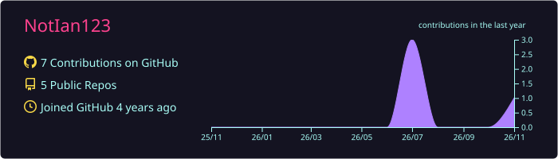
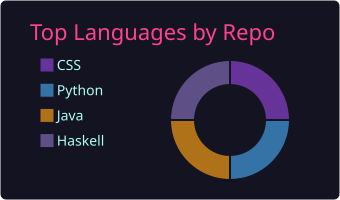
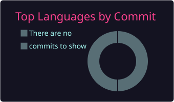
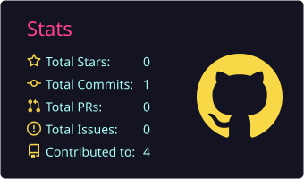

<!-- ================= 动画横幅 ================= -->

<!-- ================= 打字机动画 ================= -->

  

  
  
  

---

##  About Me

- 🎓 **Computer Science graduate** (Advanced CS major) from **Monash University** — WAM 78.4, Distinction
- ⚡ Built a **3-node RTX A5000 GPU cluster** from bare metal — **275.76 TFLOPS FP16**, 2.52× N-body speedup
- 🛡️ Cybersecurity research intern at **SHRDC** — deployed a multi-node **Wazuh SIEM/XDR** with Suricata & FIM
- 🤖 Integrating **LLMs** (Gemini, Ollama) into real applications
- 🌏 Speaks English · 中文 · Bahasa Melayu
- 🚀 Looking for **software / infrastructure / ML engineering** roles

---

## 🛠️ Tech Stack

  
   
  
   
  

  
  
  
  
  

---

## 🔭 Featured Projects

| | Project | What it is | Stack |
|:-:|---|---|---|
| ⚡ | [**gpu-hpc-cluster**](https://github.com/NotIan123/gpu-hpc-cluster) | 3-node RTX A5000 GPU cluster from bare metal — 275.76 TFLOPS FP16, 84% N-body scaling efficiency | `SLURM` `MPI/CUDA` `Docker` `BeeGFS` |
| 🐉 | [**elemental-survival-game**](https://github.com/NotIan123/elemental-survival-game) | OOP survival game with a Gemini-powered AI Oracle NPC and a State-pattern dragon boss | `Java` `Gemini API` `JUnit` |
| λ | [**functional-programming**](https://github.com/NotIan123/functional-programming) | BNF→Haskell transpiler built on parser combinators, plus an FRP Flappy Bird | `Haskell` `TypeScript` `RxJS` |

---

## 📊 GitHub Stats

  

  
  
  

  

---

## 🐍 Contribution Snake

  <picture>
    <source media="(prefers-color-scheme: dark)" srcset="https://raw.githubusercontent.com/NotIan123/NotIan123/output/github-snake-dark.svg" />
    <source media="(prefers-color-scheme: light)" srcset="https://raw.githubusercontent.com/NotIan123/NotIan123/output/github-snake.svg" />
    
  </picture>

<!-- ================= 底部波浪 ================= -->

